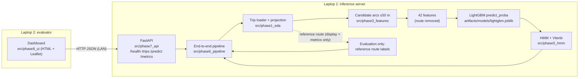

# PathSnap Architecture

## Request flow (`POST /predict {"trip_id": "00000052"}`)
1. **Load** one trip: `.track`, `.nodes`, `.arcs` and `.route`. Positions are projected to local metres.
2. **Candidates:** every arc within 50 m of each GPS point. This is an exact radius search over densified arcs with a cKDTree.
3. **Features:** 42 per-candidate features covering distance, heading, speed, topology and temporal consistency. `process_trip` sets `trip.route = None` before any feature is computed.
4. **Emissions:** the saved LightGBM model's `predict_proba`, using the same 42 columns, order and `float32` dtype as in training.
5. **ML-only baseline:** the per-point argmax of that probability.
6. **HMM + Viterbi:** the sequence decoding described below.
7. **Geometry:** decoded arcs are compressed into connected `[lat, lon]` polylines.
8. **Metrics:** computed after inference. The reference route is used only here and for drawing the ground-truth layer.

## HMM / Viterbi (src/phase5_hmm)
| Part | Definition |
|---|---|
| Hidden state | a candidate arc of GPS point *k*, plus the point's projection *t* along that arc |
| Emission | `log(clip(p_LightGBM, 1e-6, 1))` |
| Transition *a → b* | Newson–Krumm: `-|d_route − d_gps| / β` (β = 10 m), where `d_route = (1−t_a)·len(a) + shortest_path(to(a) → from(b)) + t_b·len(b)` on the **directed** graph |
| Speed check | `−0.5 · max(0, d_route/Δt − 45 m/s)` |
| Same or parallel arc | `d_route = |t_b − t_a|·len`; moving more than 5 m backwards costs 0.2 nat/m |
| U-turn onto the reverse twin | −3 nats |
| Unreachable | a finite −50, so the decoder never fails on map gaps |
| Shortest paths | bounded Dijkstra (radius 3·d_gps + 250 m, power-of-two buckets), cached per source node |
| Decoding | exact max-sum Viterbi with back-pointers, O(N·K²) |
| Chains | restart at time gaps > 30 s or time-segment changes |
| No candidates | arc −1 with status `no_candidates`; nothing is invented |
| Duplicates | duplicate (point, arc) rows are removed |

The settings were fixed before evaluation. Tests (`tests/test_phase5_hmm.py`) check that Viterbi matches brute force on random problems, and that it overrides a per-point argmax when connectivity demands it.
