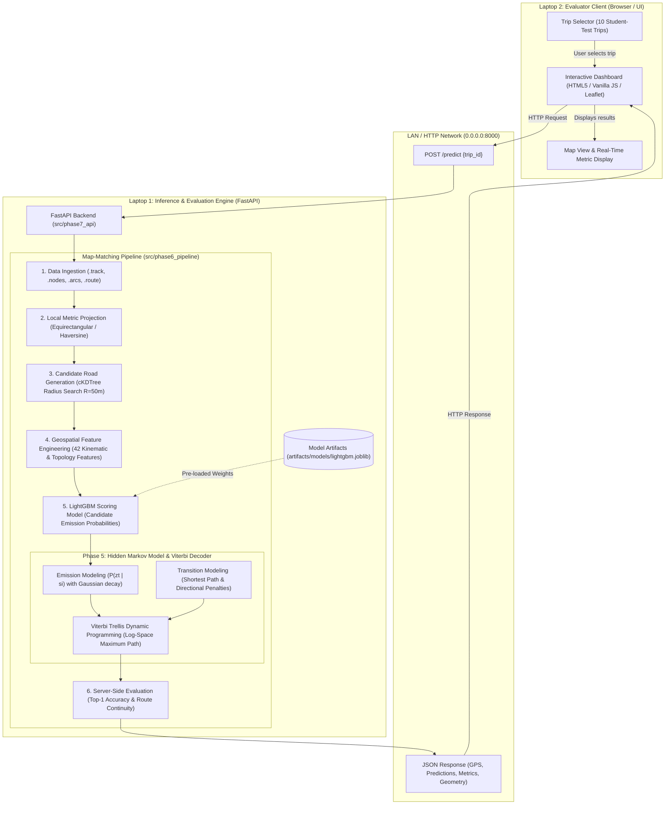

# PathSnap: System Architecture & Data Flow

## 1. End-to-End System Architecture

---

## 2. Component Explanations

### 1. Data Ingestion & Local Metric Projection (`src/phase1_eda` & `src/phase2_preprocessing`)
- **Inputs**: Raw whitespace-separated files: `.track` (GPS lon, lat, timestamp), `.nodes` (intersection vertices), `.arcs` (directed segments).
- **Metric Projection**: Projects angular spherical coordinates (degrees) into metric space (meters) using local equirectangular projection centered at the trip centroid. Avoids Euclidean angular distortions.
- **Kinematics**: Computes point-to-point displacement $\Delta s$, time interval $\Delta t$, speed $v = \Delta s / \Delta t$, and compass bearing.

### 2. Candidate Road Generation (`src/phase3_features/candidate_generator.py`)
- **Spatial Indexing**: Densifies arc geometry and indexes segments using `scipy.spatial.cKDTree`.
- **Search Radius**: Queries candidates within $R = 50\text{ m}$ of each GPS observation.
- **Efficiency**: Reduces search space from 50,000+ network arcs down to ~8–12 highly relevant candidates per GPS point in sub-millisecond time.

### 3. Geospatial Feature Engineering (`src/phase3_features/feature_engineering.py`)
- Computes **42 domain-specific features** for each `(GPS point, candidate arc)` pair without data leakage:
  - **Geometric Distance**: Perpendicular distance from GPS point to arc line segment, along-track projection parameter $t \in [0, 1]$, end-point distances.
  - **Directional Alignment**: Angular difference between GPS bearing and road segment orientation vector $|\Delta \theta|$.
  - **Kinematic Plausibility**: Comparison between observed vehicle velocity and road segment properties.
  - **Network Topology**: Connectivity flags and distance to candidates of adjacent timestamps.

### 4. Machine Learning Classifier (`src/phase4_models/train_models.py`)
- **Model**: LightGBM Classifier (fast histogram-based gradient boosted decision trees).
- **Role**: Evaluates the 42 features to predict the probability that a candidate arc is the true road segment traversed by the vehicle.
- **Accuracy**: Achieves **89.52% Top-1 Point Accuracy** standalone on student-test trips.

### 5. Hidden Markov Model & Viterbi Decoder (`src/phase5_hmm/hmm_decoder.py`)
- **Hidden States**: Candidate road arcs at each time step $t$.
- **Emission Probabilities**: Combines calibrated LightGBM predicted probability with Gaussian spatial measurement likelihood $P(z_t \mid s_i) \propto P_{\text{ML}}(s_i) \cdot \exp\left(-\frac{d^2}{2\sigma_z^2}\right)$.
- **Transition Probabilities**: Road-network shortest path distance versus great-circle distance $P(s_j \mid s_i) \propto \exp\left(-\frac{|d_{\text{network}} - d_{\text{great\_circle}}|}{\beta}\right)$, with heavy penalties for speed violations, backward travel, and invalid U-turns.
- **Viterbi Decoding**: Dynamic programming in log-space identifying the global optimal sequence of connected road segments.
- **Result**: Boosts point accuracy to **94.15%** and route continuity (reach-3) to **99.92%**.

### 6. FastAPI Backend (`src/phase7_api/app.py`)
- High-performance asynchronous REST API running on Uvicorn (`0.0.0.0:8000`).
- Keeps model and network topology resident in memory for sub-second inference.
- Serves endpoints: `/health`, `/trips`, `/predict`, `/metrics`, and `/ui/`.

### 7. Evaluator Interface (`src/phase8_ui/`)
- Responsive dashboard with modern glassmorphism UI.
- Interactive Leaflet map displaying raw noisy GPS (blue dots), ML-only route (orange), HMM Viterbi route (green), and ground-truth reference (purple).
- Bundled local Leaflet assets for offline resilience, with Esri Canvas Clean and OpenStreetMap layer options.
